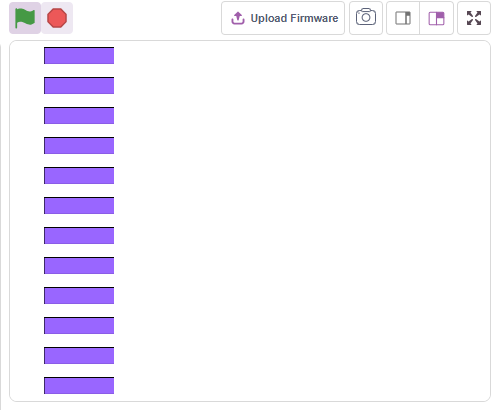
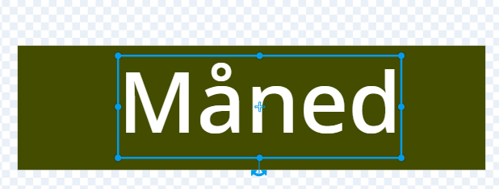
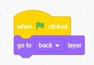
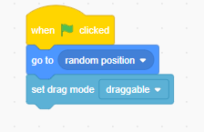
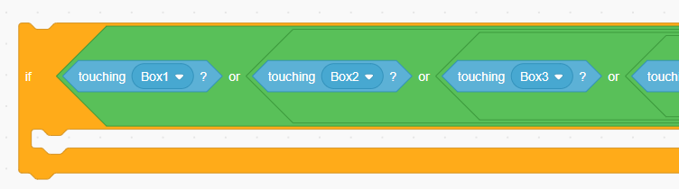
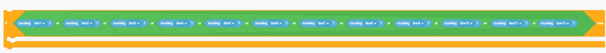

# Måneds-spil

Vi skal lave et simpelkt træk-og-slip spil, hvor de 12 måneder skal placeres rigtigt.

Til dette får vi brug for at oprette 24 sprites (og slette tobi):

 * Vi skal have 12 bokse vi kan lande månederne i.  
   Det letteste er at oprette en sprite der hedder "box1" med den rigtige grafik, og så dublikere denne så vi får 12.  
   De 12 bokse skal placeres på skærmen så man kan se en rækkefølge i dem. Jeg valgte at placere mine i en række i venstre side af skærmen:
     
   For at spillet skal virke skal boksene stå i rigtige rækkefølge, så "box1" kommer først, så "box2" og til sidst "box12".

 * Vi skal have 12 sprites med månederne.  
   Det letteste er at lave en boks til at vise måneder og tilføje teksten "måned".  
     
   Hereftert kan spriten dublikeres 12 gange, så de ser ens ud. Endelig skal hver "kostume" redigeres så der står et måneds-navn i boksen.  
     
   Kan du stave alle 12 måneder rigtigt?

## Kode til "box" sprites
Det er en god ide at ligge en stump kode ind på den ene box-sprite og så kopiere dette til de andre "box" sprites.

En "box" sprite skal sørge for at være bagved vores "måned" sprites. Vi tilfører derfor denne kode sekvens:

## Kode til "måned" sprites
Logikken til månederne er lidt mere besværlig. Det er en god ide at forsøge at strukturere sin kode så den kan laves på en måned og herefter kopieres til de andre måneder uden man skal lave for meget om.

Når spillet startes skal vi have blandet brikkerne. Det gør vi ved at flytte dem til en tilfældig position. Samtidig skal vi tillade at spilleren kan flytte brikkerne, så vi slår "drag mode" til:

Herefter kan vi tilføje noget mere kode der bliver ved med ("For evigt") at se om vi rør en af boksene.

Hvis vi rører en boks, og det er den boks vores måned hører til i, skal brikken sætte sig fast på feltet.  
Tænk over hvordan vi kan gøre det.

Hvic vi rører en forkert boks, skal måneden blive kastet væk og lande et nye sted på skærmen. Måske vi allerede har sat en blok ind der kan gøre det når vi starter spillet?.

For at se om vi rører en boks, bliver vi nok nødt til at spørge om vi rører "box1" eller "box2" eller "box3" eller "box4" eller "box5" eller "box6" eller "box7" eller "box8" eller "box9" eller "box10" eller "box11" eller "box12". Det bliver en lidt lang kodeblok, man kan opbygges som:

__Husk!__ - Det er en god ide at teste det hele virker med den første måned før du laver resten. Herefter kan koden kopieres rundt.

## Ekstra opgave 1
Tilføj en lyd når man sætter måneden rigtig? Måske en klappe lyd?

Tilføj en fjollet lyd når man sætter måneden et forkert sted. Måske en fjerder der skyder måneden væk igen?

## Ekstra opgave 2
Når man sætter en vintermåned rigtigt skal baggrunden i spillet skifte til et vinter billede og når man sætter en sommermåned rigtigt skal baggrunden skifte til en sommer måned.

Er der kun to årstider, eller skal der bruges flere baggrunde?

## Afslutning

Spil spillet og vis at du kan placere alle månederne rigtigt :-)